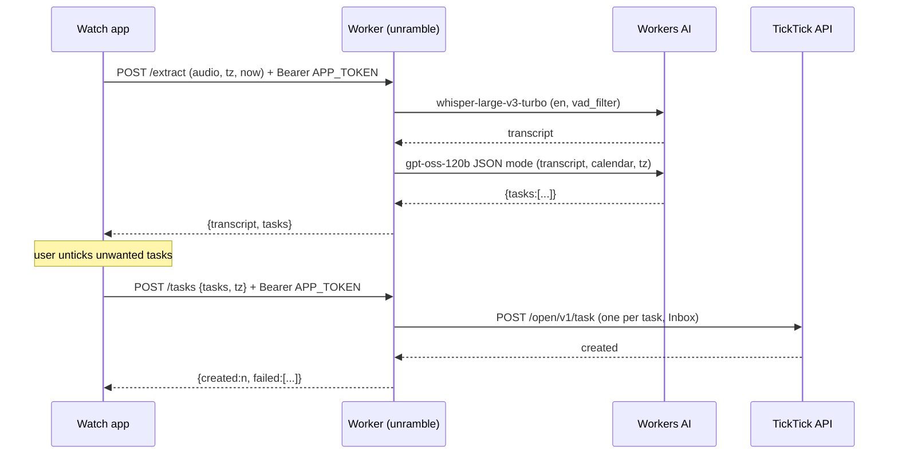
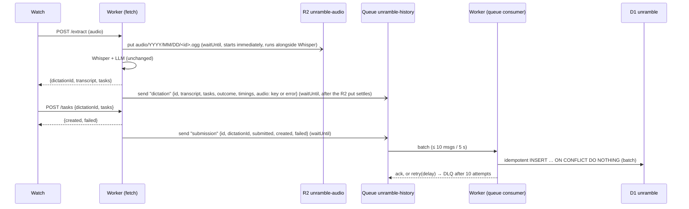

# Unramble: voice → TickTick tasks (Galaxy Watch 8)

Press a button on the watch, dictate, review the extracted tasks, and send them to the TickTick Inbox. (Working name was "Voice Tasks"; renamed to **Unramble** on 2026-11-17: app ID `dev.flashblaze.unramble`, Worker `unramble`. User-facing docs: `README.md`.)

## Decisions

| Topic | Choice | Why |
|---|---|---|
| Speech source | Dictation only: every word you say counts | No speaker separation needed, so it's more accurate |
| After processing | Review screen on the watch with toggles, then **Create** | Bad extractions never reach TickTick |
| AI provider | Cloudflare Workers AI: `@cf/openai/whisper-large-v3-turbo` + `@cf/openai/gpt-oss-120b` (JSON mode, `reasoning_effort: low`), falling back to `@cf/meta/llama-3.3-70b-instruct-fp8-fast` on error or after 25 s | Free at personal volume, one account, no extra API keys; Whisper on Workers AI is zero-data-retention; gpt-oss-120b scored 30/30 in Phase 0 |
| TickTick list | Inbox | — |
| Language | English (`language: "en"` passed to Whisper) | — |
| Max recording | 5 min, then it stops automatically | Ogg/Opus 16 kHz mono 24 kbps: about 800 KB, uploads in one go |
| Phone app | None | The watch talks to the Worker directly over Wi-Fi/LTE/Bluetooth proxy |

### Cost (Workers AI free allowance: 10,000 neurons/day)

Measured in Phase 0: Whisper 47 neurons per audio minute; gpt-oss-120b about 50 neurons per extraction (≈1k-token prompt).

| Per recording | Whisper | LLM | Total |
|---|---|---|---|
| 1 min | 47 | ~50 | ~100 neurons → ~100 recordings/day free |
| 5 min | 233 | ~50 | ~285 neurons → ~35 recordings/day free |

Above the free allowance (Workers Paid plan only): $0.011 per 1,000 neurons, about $0.003 per 5-minute recording.

## Architecture



Secrets are stored only as Worker secrets: `APP_TOKEN` (watch → Worker) and `TICKTICK_TOKEN`. The watch app holds only `APP_TOKEN`, read from `local.properties` into `BuildConfig` at build time, so it never reaches git. The Worker never stores audio.

## Repository layout

```
unramble/
  app/                    Wear OS app (Compose for Wear OS, Material3)
  worker/                 Cloudflare Worker (TypeScript, wrangler)
    src/index.ts          router, bearer auth, body limits, structured logs
    src/extract.ts        Whisper, prompt, gpt-oss-120b → llama fallback
    src/tasks.ts          zod schemas: Task, /tasks body, model output + grounding guard
    src/dates.ts          time-zone math: prompt calendar, local due → TickTick date
    src/ticktick.ts       TickTick client (Inbox)
    src/quota.ts          Durable Object: strict per-credential quota (10/min, 30 extracts/day)
    src/errors.ts         log-safe error summaries (no transcript text)
    scripts/auth.ts       TickTick OAuth on the laptop → .dev.vars + Worker secret
    scripts/wrangler.sh   runs wrangler with the cf CLI login
    test/                 vitest in the Workers runtime (@cloudflare/vitest-plugin)
  PLAN.md
```

## Task JSON (the contract between LLM, Worker and watch)

The LLM returns, per task (field order matters, see Phase 0):
`title`, `when_said` (your exact timing words), `due`, `priority_said` (your exact importance words), `priority`, `notes`.

The Worker enforces the grounding in code: no `when_said` → `due` dropped; no `priority_said` → `priority = 0`. It then returns this to the watch:

```json
{
  "transcript": "remind me to call the bank tomorrow at 10 and also buy milk",
  "tasks": [
    { "title": "Call the bank", "due": "2026-11-17T10:00", "priority": 0 },
    { "title": "Buy milk", "priority": 0 }
  ]
}
```
- `due` is local time without an offset: `YYYY-MM-DD` (all day) or `YYYY-MM-DDTHH:MM` (timed), or absent. The watch sends its zone (e.g. `Asia/Kolkata`), and the Worker converts to TickTick's `yyyy-MM-dd'T'HH:mm:ssZ` (with offset) plus `timeZone`. Phase 0 confirmed `2026-11-17T10:00:00+0530` with `timeZone: Asia/Kolkata` is stored as 10:00 IST.
- `priority` maps to TickTick: 0 none, 1 low, 3 medium, 5 high.
- `notes` (optional) becomes the TickTick task `content`.
- The Worker validates every field (title 1–200 chars, date parses, priority in the allowed set). Invalid items are dropped, never sent to TickTick.

## Phases

### Phase 0: risk spikes ✅ done 2026-11-16
Harness and samples: `worker/spike/` (gitignored). Prompt to port: `worker/spike/prompt-v4.txt`, schema: `worker/spike/schema-v4.json`.

1. **Whisper input ✅** Test audio was a TTS-generated dictation, looped to 5 min, 16 kHz mono.

   | Clip | Size | Time | Result |
   |---|---|---|---|
   | 5 min Ogg/Opus 24 kbps | 804 KB | 25.6 s | 920 words, accurate |
   | 5 min M4A/AAC 32 kbps | 1.17 MB | 35.2 s | 921 words, accurate |

   Single call, no splitting needed. **Use Ogg/Opus**: smaller and faster.
   Quirks: Whisper invents a "Thank you." on trailing silence, and long audio loses capitalization partway through. The prompt ignores a stray "thank you"; casing doesn't matter to the LLM.
2. **LLM extraction ✅** 10 cases (multi-task ramble, no tasks, no date, time today, self-correction, recurring, other people's actions, item list, "in two hours" across midnight, "a week before Dec 3"), 3 runs each, scored automatically.

   | Prompt | llama-3.3-70b | gpt-oss-120b | qwen3-30b |
   |---|---|---|---|
   | v1: plain rules | ~5/10 | — | — |
   | v2: + 15-day calendar table | 8/10 | 9/10 | 9/10 |
   | v3: + 45-day calendar | 24/30 | 26/30 | 26/30 |
   | **v4: 21-day calendar + `when_said`/`priority_said` grounding + code guard** | 29/30 | **30/30** | 29/30 |

   What fixed it: the model looks weekdays up in a calendar instead of computing them. It must quote your timing and importance words before giving a date or priority, and the Worker drops any date or priority without a quote. gpt-oss-120b: p50 6.6 s, max 23.8 s.
3. **TickTick ✅** `scripts/auth.ts` (localhost:8765 OAuth) works, and the token lasts **180 days**. `POST /open/v1/task` **without `projectId`** lands in Inbox (project ID `inbox<user-id>`). `DELETE /open/v1/project/{pid}/task/{id}` works.

Worst case per request: upload + 26 s Whisper + 24 s LLM ≈ 60 s, so the watch timeout is 120 s.

### Phase 1: Worker ✅ done 2026-11-16
Deployed on a custom domain, **`https://unramble.<your-domain>`** (`routes` + `"workers_dev": false` in `wrangler.jsonc`; logs and traces on at 100%). It started on `workers.dev` under the working name `voice-tasks`. Code in `worker/`. Commands (run in `worker/`):

| Command | What |
|---|---|
| `bun run deploy` | deploy (wrangler borrows the `cf` CLI login via `scripts/wrangler.sh`) |
| `bun run auth` | TickTick OAuth → `.dev.vars` + Worker secret `TICKTICK_TOKEN` (rerun every 180 days) |
| `bun run test` / `bun run typecheck` | 34 tests in the Workers runtime / tsc |
| `bun run types` | regenerate `worker-configuration.d.ts` after changing `wrangler.jsonc` |
| `bun run wrangler tail unramble` | live logs (JSON: request ID, sizes, task count, model, whisperMs, llmMs, never transcript text) |

**API** (all routes: `POST`, `Authorization: Bearer <APP_TOKEN>`; errors are `{"error": "<code>"}`):

| Route | Body | 200 response | Errors |
|---|---|---|---|
| `/extract?tz=<IANA zone>` | raw Ogg/Opus audio, ≤ 1.5 MB | `{transcript, tasks: [{title, due?, priority, notes?}]}` | 400 `bad_timezone` / `empty_audio`, 413 `too_large`, 422 `no_speech` |
| `/tasks` | `{tz, tasks: [...]}` (1–20, as returned by `/extract`) | `{created: [{title, id}], failed: [{index, title, error}]}` | 400 `bad_request` / `bad_timezone`, 413 `too_large`, 502 `ticktick_auth_expired` (+ `created` so far) |

Shared: 401 `unauthorized` (checked before anything else), 429 `rate_limited` + `Retry-After` (quota, below), 404 `not_found`, 405 `method_not_allowed`, 500 `internal`. Retry `/tasks` with only the `failed` **positions** (`index`), so nothing is duplicated even when titles repeat.

**Verified:**
- `curl` with the 30 s dictation returned 5 correct tasks: dates, all-day vs timed, and priority 5 for "high priority". `/tasks` created all 5 in Inbox. Read back from TickTick: 10:00 IST is stored as `04:30Z`, all-day dates as local midnight. Test tasks deleted afterwards.
- Latency: Whisper about 5 s for 30 s of audio. gpt-oss-120b at default effort took 29 s under load. With `reasoning_effort: low` the typical response is 7.7 s and accuracy still 29/30; its one failure was the test client's own 60 s timeout. Requests that stall past 25 s fall back to llama. End to end: 30 s clip about 19–35 s, 5-min clip 57 s.
- The Worker sends gpt-oss the JSON schema in OpenAI format (`json_schema: {name, schema}`): re-evaluated at 30/30.

Gotchas:
- A first deploy with `secrets.required` needs `bun run deploy -- --secrets-file .dev.vars`, because a Worker that doesn't exist yet can't take `secret put`.
- `.dev.vars` holds `APP_TOKEN` and `TICKTICK_TOKEN`; `.env` holds the TickTick client ID and secret. Both are gitignored.

### Phase 2: watch app ✅ done 2026-11-17
Code in `app/src/main/java/dev/flashblaze/unramble/`:

| File | What |
|---|---|
| `RecorderService.kt` | Foreground service (type microphone): MediaRecorder Ogg/Opus, 16 kHz mono, 24 kbps → `cacheDir/dictation.ogg`, auto-stop at 5:00, Wear Ongoing Activity chip with a stopwatch. Publishes `Recorder.state` (Idle / Recording / Finished / Failed) so the UI resumes after screen-off or activity recreation. |
| `TasksApi.kt` | OkHttp + kotlinx.serialization client for `/extract` and `/tasks` (120 s timeout); Worker errors → `ApiException(code)` |
| `MainViewModel.kt` | State machine `Idle → Recording → Uploading → Review → Creating → Done`, plus `NothingHeard`, `Error(retry)`, `MicPermissionDenied`. Keeps the audio until tasks are created, so Retry never re-records; a partial `/tasks` failure keeps only the failed tasks. |
| `MainActivity.kt` | Compose for Wear OS Material3 screens. Every screen is a `TransformingLazyColumn`, so text scrolls on the round display. |

Config: `unramble.workerUrl` and `unramble.appToken` in `local.properties` (gitignored) → `BuildConfig`. Unit tests: `./gradlew :app:testDebugUnitTest` (`TasksApiTest`: request body and error mapping).

**Verified on the Wear OS 6 emulator:**
- Mic and notification permission prompts.
- Foreground service running with type microphone (`0x80`), stopwatch notification.
- Recording → upload → Review in about 5–9 s for a 4 s phrase.
- "No speech heard" path.
- Acceptance: "Buy milk, and call mom tomorrow at 6 PM" → Review lists **Buy milk** and **Call mom · Tomorrow 18:00** → Add 2 → "Added 2 tasks to TickTick". Read back from TickTick: Call mom `2026-11-18T12:30Z` (18:00 IST, timed), Buy milk undated, both in Inbox. Test tasks deleted afterwards.

Fixed along the way:
- **`/tasks` returned `bad_request`:** kotlinx.serialization skips default values, so `priority: 0` was never sent. Fixed with `encodeDefaults = true` (nulls are still omitted via `explicitNulls = false`), and a regression test added.
- Wear M3 `TextButton` is a small round icon button, so labels wrapped. Secondary actions now use `CompactButton`.
- The recording screen has a big central Stop button instead of an edge button.
- `Status.StopwatchPart` counts from an `elapsedRealtime()` base (checked in the bytecode), not wall-clock time.

UI notes: the edge button (e.g. "Add 2") collapses while the list can still scroll and appears at the end, the standard Wear pattern; scroll with the crown/bezel. "Buy milk and call mom tomorrow at 6 PM" sometimes gives *both* tasks the date. The sentence is ambiguous, and the review screen shows it.

**Emulator testing notes** (this machine): the emulator can't open PipeWire/PulseAudio/ALSA (`Could not init 'pa' audio driver`), so host-mic tests are impossible. Instead, `tools/emulator/inject_audio.py --burst` streams a WAV into the virtual mic through gRPC `injectAudio`. Start the emulator with `-grpc 8554 -grpc-use-token`; plain `-grpc` listens on all interfaces without auth. Gotchas:
- Injecting when no guest app is recording **crashes the emulator** (SIGSEGV).
- Injection is flaky: roughly 1 in 3 recordings receive the audio.
- A cold boot shows the "Hello" onboarding over the app; swipe up once.

`tools/emulator/tap.sh "<label>"` taps a UI node by its text.

### Security audit + code review fixes ✅ 2026-11-17
A read-only security audit and a code review found no critical or high issues. Fixed:

| # | Finding | Fix |
|---|---|---|
| 1 | Retrying a partial `/tasks` failure matched by **title**, so same-titled tasks were re-created | `failed[]` carries `index`; the app retries `CreateResult.failedOf(sent)` by position. Regression tests: Worker `index.test.ts` and app `TasksApiTest` |
| 2 | No rate limit; `APP_TOKEN` ships in the APK, so a leaked token could drain the account's Workers AI free allowance (~35 five-minute requests) or flood the Inbox | **Strict per-credential quota**, Durable Object `src/quota.ts` (SQLite, synchronous): **10 requests/min** and **30 `/extract` per rolling 24 h** (≤ ~8.5k neurons). Checked right after auth, so unauthenticated requests can't lock you out. The Workers Rate Limiting binding was tried first: it is approximate and per location, and never tripped in 80 test requests. Audio cap lowered from 3 to 1.5 MB. Verified live: 10 × 404 then 429 with `Retry-After`. |
| 3 | An over-long title or notes dropped the whole task silently | Truncated to 200 / 2,000 characters instead (test added) |
| 4 | A blank `WORKER_URL` crashed the app at ViewModel creation | `TasksApi` is created lazily; `record()` shows the config error |
| 5 | Error logs could include transcript text (JSON parse errors quote model output; TickTick error bodies) | `errorSummary()`: parse errors logged by name only, other messages capped; `TickTickError` carries only the status |
| 6 | Review screen hid notes and priorities 1 and 3, which were still sent | Shows date · Low/Medium/High plus notes (up to 4 lines) |
| + | A stalled gpt-oss call kept running (and using neurons) after the 25 s fallback | `ai.run(..., { signal: AbortSignal.timeout(25_000) })` |
| + | `allowBackup="true"` | `false` |

**Accepted for a personal app:**
- Blocking OkHttp calls aren't cancelled when the app is swiped away, so in-flight results are lost.
- An unexpected response shape throws `SerializationException`, which is uncaught.
- A double Stop leaves an idle service running.
- DST-gap date math is off for some zones (Asia/Kolkata has no DST).
- The TickTick scope includes `tasks:read`.
- `APP_TOKEN` is readable from the APK. Rotate it if the APK leaks: `bun run wrangler secret put APP_TOKEN`, update `local.properties`, reinstall.

Git history scanned: no secret values are present in any commit.

### Phase 2b: dictation history: transcripts + audio ✅ built 2026-11-17
Goal: keep every dictation (the **audio**, the **transcript**, what the model **proposed**, what you **kept**, and what TickTick **created**) so you can look back later, without ever slowing down or breaking the main flow. Workers Paid plan.

**Decision: audio → R2 (written directly in the background), records → Queue → D1.**

| Option | Verdict |
|---|---|
| **D1** for records ✅ | Text rows you list and search: SQL, FTS5 full-text search, dashboard console, `wrangler d1 execute`, migrations, Time Travel restore (30 days). |
| **R2** for audio ✅ | Blob storage, private by default, lifecycle rules for expiry. ~0.4 MB per dictation. |
| **Queues** for D1 writes ✅ | Durable, at-least-once, automatic retries (`max_retries`), dead-letter queue, batching. Producer `send()` is a few ms and runs after the response. |
| Workflows ❌ (for now) | Built for multi-step orchestration (sleeps, waits, per-step retries). Here there's one idempotent write per event; a Workflow instance per dictation is overhead. Worth it later for real pipelines (e.g. re-transcribe, daily digest), which can consume the same R2 + D1 data. |
| Audio *through* a queue/workflow ❌ | Too big: Queue messages max **128 KB**, Workflow params/step results max **1 MiB**, and audio is up to 1.5 MB. Audio must go to R2 directly; messages carry the R2 key. |
| Durable Object for records ❌ | Only reachable through Worker code: no console, CLI or backups. |
| Plain `ctx.waitUntil` D1 writes ❌ | No retries: a transient D1 error or a deploy mid-flight loses the record. |

**Flow: nothing on the watch's critical path waits for storage**

Guarantees:
- **Main flow unchanged.** The request never `await`s R2, the queue or D1. Each of those runs in `ctx.waitUntil()`, which gets up to 30 s after the response; a 1 MB R2 put takes well under 1 s. Every background chain catches its own errors and logs `errorSummary` only, so a storage failure can't produce a 500 or add latency.
- **Audio is saved even when processing fails.** The R2 put starts as soon as the body is read, *before* Whisper. If Whisper or the LLM throws, the queue message records `outcome: "failed"` plus the error type. Failed dictations are the ones most worth listening to.
- **R2 put retries** up to 3× with backoff inside `waitUntil`. If it still fails, the message records `audio_error`, so the row exists without audio.
- **Order and duplicates don't matter.** Submissions live in their own table keyed by a per-call `submissionId`, so a "submission" arriving before its "dictation", or delivered twice, is harmless: everything is `INSERT … ON CONFLICT DO NOTHING`, joined at read time.
- **Message size:** a transcript is ≤ ~8 KB for 5 min of speech, plus ≤ 20 tasks, so well under 128 KB (usually one 64 KB billing unit).

**Schema** (`worker/migrations/0001_history.sql`):
```sql
CREATE TABLE dictations (
  id             TEXT PRIMARY KEY,      -- UUID, returned to the watch as dictationId
  created_at     INTEGER NOT NULL,      -- unix ms
  tz             TEXT NOT NULL,
  outcome        TEXT NOT NULL,         -- 'extracted' | 'no_speech' | 'failed'
  error          TEXT,                  -- error type when failed (never message text)
  transcript     TEXT,                  -- null if Whisper failed
  extracted_json TEXT,                  -- tasks the model proposed
  model          TEXT,
  audio_key      TEXT,                  -- R2 key; null if the put failed
  audio_bytes    INTEGER NOT NULL,
  audio_error    TEXT,
  whisper_ms     INTEGER,
  llm_ms         INTEGER
);
CREATE INDEX dictations_created_at ON dictations (created_at DESC);
CREATE TABLE submissions (
  id             TEXT PRIMARY KEY,      -- per /tasks call: idempotency for at-least-once delivery
  dictation_id   TEXT NOT NULL,
  created_at     INTEGER NOT NULL,
  submitted_json TEXT NOT NULL,         -- tasks you kept and sent
  created_count  INTEGER NOT NULL,
  failed_count   INTEGER NOT NULL
);
CREATE INDEX submissions_dictation ON submissions (dictation_id);
-- Full-text search over transcripts, kept in sync by insert/delete triggers.
CREATE VIRTUAL TABLE dictations_fts USING fts5 (transcript, content = 'dictations', content_rowid = 'rowid');
```

**Worker changes**
- `wrangler.jsonc` (resources without IDs are auto-provisioned on the first deploy, and the IDs are written back):
  - `r2_buckets: [{ binding: "AUDIO" }]` → bucket `unramble-audio`, private (no r2.dev, no custom domain).
  - `d1_databases: [{ binding: "DB", database_name: "unramble", migrations_dir: "migrations" }]`.
  - `queues.producers: [{ binding: "HISTORY", queue: "unramble-history" }]`.
  - `queues.consumers: [{ queue: "unramble-history", max_batch_size: 10, max_batch_timeout: 5, max_retries: 10, retry_delay: 30, dead_letter_queue: "unramble-history-dlq" }]`. Create the DLQ once with `wrangler queues create unramble-history-dlq`.
  - `vars`: `SAVE_HISTORY = "true"` (forks can turn it off), `HISTORY_RETENTION_DAYS = "0"` (0 = keep records forever).
  - `triggers.crons: ["17 3 * * *"]`: daily purge of D1 rows older than the retention period, when it's set.
- `src/history.ts`:
  - `saveAudio()`: R2 put with retries, `customMetadata` = {tz, bytes}.
  - `enqueueDictation()` / `enqueueSubmission()`: build and `send` the messages.
  - `consume(batch)`: zod-validate each message, one `DB.batch()` of idempotent inserts, then `ackAll()`. On a D1 error, `retryAll({ delaySeconds })`. A message that fails validation is acked and logged; retrying won't fix it.
- `src/index.ts`:
  - `export default { fetch, queue, scheduled }`.
  - `/extract` generates `dictationId` and returns it.
  - `/tasks` accepts an optional `dictationId`.
  - Both register their background chains through `ctx.waitUntil`.
- Audio retention lives in R2 itself: lifecycle rule `wrangler r2 bucket lifecycle add unramble-audio expire-audio --prefix audio/ --expire-days 365`. The default is **365 days for audio** (voice is the most sensitive data here; change or remove the rule to taste). Transcripts are kept until `HISTORY_RETENTION_DAYS` says otherwise. The listing shows "audio expired" when a row's key no longer exists.

**App changes:** `Extraction.dictationId` is kept in the ViewModel and sent with every `/tasks` call (including retries). No new screens.

**Viewing it later** (`worker/scripts/history.ts`, via `scripts/wrangler.sh`, `--remote`)
- `bun run history`: the last 20 dictations, with local time, outcome, 🎧 if audio exists, transcript, proposed vs kept titles, and created count.
- `bun run history --search "plumber"`: FTS5 search with highlighted matches.
- `bun run history --id <id>`: one dictation in full (JSON).
- `bun run history --play <id>`: downloads the audio with `wrangler r2 object get unramble-audio/<key> --remote` to a temp file and plays it with `mpv`/`ffplay`, falling back to `xdg-open`. `--save <id> <file>` keeps it.
- `bun run history --dlq`: shows messages stuck in the dead-letter queue (they should never appear).
- `bun run history --purge-older-than 90d`: manual purge of D1 rows and their R2 objects.
- Dashboard: D1 Console for SQL, the R2 bucket browser for audio. Export with `wrangler d1 export unramble --remote`.

**Security and privacy**
- **No HTTP read path.** Reading history or audio needs your Cloudflare account. A leaked `APP_TOKEN` can only *add* dictations, capped by the quota (30 × 1.5 MB/day).
- R2 is private and encrypted at rest; there is no public URL.
- Logs stay free of transcripts. Queue messages contain transcripts, but they live only inside your account until consumed (or in the DLQ).
- README "Security and privacy" changes from "never stored" to: "audio (R2, expires after 365 days) and transcripts (D1) are stored in **your** Cloudflare account; turn off with `SAVE_HISTORY=false`". Deleted D1 rows remain recoverable via Time Travel for 30 days.

**Cost at personal volume (paid plan, 30 dictations/day worst case)**

| Resource | Usage/month | Included | Cost |
|---|---|---|---|
| R2 storage | ~0.4 GB added | 10 GB-month | $0 (≈ 5 GB after a year) |
| R2 Class A (puts) | ~900 | 1M | $0 |
| Queues | ~1,800 messages × 3 ops ≈ 5.4k | 1M ops | $0 |
| D1 | ~10k rows written | 50M | $0 |

**Tests (vitest-plugin: D1 migrations applied, local R2, `createMessageBatch` / `getQueueResult`)**
- `/extract` response is unchanged when R2, the queue or D1 throw (main flow isolated).
- A failed extraction still enqueues `outcome: "failed"` with the audio key.
- Consumer: insert → read back; the same message twice → one row; a submission before its dictation → both rows, joined correctly; a D1 error → `retryAll`; an invalid message → acked + logged.
- FTS search finds a word in a transcript.
- The retention cron deletes only old rows.
- R2 put retry gives up after 3 attempts and records `audio_error`.
- Latency check on the deployed Worker: `/extract` p50 before vs after stays within noise.

**Done when** a dictation on the emulator shows up in `bun run history` with transcript, proposed and kept tasks and created count; `--play` plays its audio; `--search` finds it; a forced failure (e.g. LLM error) still appears with audio; the DLQ is empty; tests pass; and the README reflects the new privacy model.

**Built** as planned:
- `worker/src/history.ts`, `migrations/0001_history.sql`, `scripts/history.ts`, `test/history.test.ts`.
- 48 Worker tests and 3 app tests pass.

Differences from the plan:
- **Resources:** created explicitly and named in `wrangler.jsonc` (`wrangler d1 create`, `r2 bucket create`, `queues create` ×2) instead of auto-provisioned, so the CLI and dashboard names are fixed. Forks run the same commands (README).
- **No `--dlq` command:** `wrangler queues info` shows no backlog count, so the DLQ backlog is read in the dashboard instead. Failed writes are also logged as `history write failed`.
- **Vars typing:** `wrangler types --strict-vars=false`, so vars are `string` rather than literal types.
- **Purge count:** the purge counts deleted dictations with `RETURNING id`, because D1's `meta.changes` includes the FTS trigger writes.

Verified on the deployed Worker:
- Three live `/extract` calls took 21.0 / 18.9 / 24.7 s, the same as before history, and returned `dictationId`. Their rows reached D1 through the queue within seconds.
- The audio saved via `bun run history --save` is byte-identical to the upload.
- `--search` highlights matches and handles a quote in the term.
- Random bytes as audio → `500 internal`, and history shows `FAILED (AiError)` with the audio kept.
- R2 lifecycle rule `expire-audio` (prefix `audio/`, 365 days) is active.

**Finding (the first thing history surfaced):** for the 30 s test clip, "by Thursday evening" came back as **Sat 21 Nov** in 2 of 3 runs (Thursday is 19 Nov), with gpt-oss-120b at `reasoning_effort: low`.
**Fixed ✅** by `alignWeekday()` in `src/dates.ts`, applied in `tasksFromModel()` to both models' output. When `when_said` names exactly one weekday and `due` falls on another day, the Worker moves the date to the first such weekday after today (in the watch's zone) and keeps the time. It leaves the date alone for arithmetic (`before`/`after`/`week`/`days`/`last`), explicit dates (ordinals, month names), and several weekdays. Covered by 5 tests, including the exact regression. Live: the same clip now gives Thu 19 Nov 18:00 in 3/3 runs (18.8–20.4 s).

### Phase 2c: vocabulary hints + playing recordings on the watch (planned)

#### Part 1: vocabulary hints
Problem: Whisper doesn't know words it rarely hears. "Unramble" came out as "and ramble"; names and jargon (people, products, places) get respelled.

**Mechanism:**
- Whisper on Workers AI accepts `initial_prompt` (confirmed in the generated types). Text there acts as preceding context and biases spelling toward the words it contains.
- The Worker sends `"Vocabulary: Unramble, TickTick, Priya, …."`. Whisper's prompt window is ~224 tokens, so cap the list at ~150 words and send the most recently added first.
- The same list goes into the extraction prompt as "Correct spellings of names the speaker uses: …", so task titles also use the right spelling when Whisper still slips.

**Storage: D1 table `vocabulary`** (migration `0002_vocabulary.sql`: `word TEXT PRIMARY KEY COLLATE NOCASE, added_at INTEGER`). It's next to history, editable from the laptop, and doesn't need a redeploy.
- The Worker reads it on `/extract` with one indexed query, cached in module memory for 5 minutes so most requests don't touch D1.
- If D1 fails, Whisper runs without the hint and the dictation is never blocked.
- Considered and rejected: a `vars` entry, which needs a redeploy for every new word; KV, which would be a second store for one list.

**Managing it:**
- `bun run vocab add "Unramble" "Priya Sharma"`, `bun run vocab remove …`, `bun run vocab list`.
- `bun run vocab suggest` lists capitalised words from your history transcripts that aren't in the list yet, for one-keystroke adding.
- The list is seeded with `Unramble`, `TickTick`.
- The watch has no UI for this; typing on a watch is the wrong place.

**Tests:**
- The prompt is built with a cap and in the right order.
- A D1 failure still transcribes.
- The extraction prompt includes the list.
- Live: the "Remind me to test Unramble…" phrasing transcribes as "Unramble" (A/B with the hint off and on, 3 runs each).

#### Part 2: play saved recordings on the watch
Goal: an **History** button on the record screen opens a list of recent dictations (time, first words, how many tasks you kept). Tapping one shows the transcript and tasks, and **Play** plays the audio on the watch speaker.

**The decision this needs** (security vs. where the audio comes from):

| Option | How | Trade-off |
|---|---|---|
| **A. Stream from R2 through the Worker** | New authenticated `GET` endpoints read D1 and stream R2 | Shows everything ever saved (until the 365-day expiry), including dictations from before a reinstall. **But it adds the HTTP read path that Phase 2b deliberately left out:** the `APP_TOKEN` is extractable from the APK, so anyone holding the APK could then *listen to your recordings and read your transcripts*, not just add dictations. |
| **B. Keep recent recordings on the watch** | The app keeps the last 20 recordings plus their transcript and tasks in app-private storage (`filesDir`, ~3–8 MB). `/extract` already returns everything needed, and `/tasks` tells the app what you kept. | No new server endpoints and no new attack surface. Works offline and plays instantly. Only shows the last 20 made *on this install*; older ones stay in R2 for `bun run history --play` on the laptop. |
| C. A then B | B now, A later behind its own revocable `HISTORY_READ_TOKEN` | Same exposure as A once added; a separate token only makes it easy to revoke reads without breaking dictation. |

**Recommendation: B.** It shows exactly what you'd want on a wrist (recent dictations), adds zero exposure, and needs no server change. Choose A if you specifically want older recordings on the watch and accept the APK-token risk.

**Plan for B (app-only):**
- `HistoryStore.kt`:
  - Each entry is `filesDir/history/<dictationId>/{audio.ogg, entry.json}`.
  - `entry.json` holds `{id, createdAt, transcript, proposed, kept, created}`.
  - On save, prune to the newest 20.
  - Writes are atomic (temp file + rename).
- **Capture:**
  - After a successful `/extract`, the recording is *moved* (not copied) into the store instead of being deleted, and the entry is written.
  - After `/tasks`, update `kept`/`created`.
  - A "No speech heard" recording is stored too, marked, so you can hear what went wrong.
- **Playback:** Media3 `ExoPlayer` (it plays Ogg/Opus) on a local file.
  - Check for audio output first with `AudioManager.getDevices(GET_DEVICES_OUTPUTS)`: watch speaker or Bluetooth headset.
  - Request audio focus, pause when leaving the screen, and use the crown for volume.
- **UI (Wear M3):**
  - The record screen gains a small **History** button.
  - The list is a `TransformingLazyColumn` of cards: "Today 08:53 · Buy milk, Call mom · ✓2".
  - The detail screen has a play/pause button with a progress ring, plus the transcript and tasks (✓ kept / · dropped).
  - Swipe-to-dismiss goes back.
- **Deleting:** a long-press on an entry offers **Delete from watch** (local only; R2/D1 stay unchanged). An "Erase all on watch" action sits at the end of the list.
- **Tests:**
  - Unit tests for `HistoryStore`: prune to 20, update kept, survives a missing file, and the JSON round-trip.
  - Emulator: dictate → History shows it → Play reaches `STATE_READY` and moves position (checked via logcat).
  - Real watch: you listen to one recording on the speaker.

**Plan for A (only if chosen), on top of B's UI:**
- `GET /history?before=<cursor>&limit=20` returns D1 rows.
- `GET /history/<id>/audio` streams the R2 object, with `Range` support so ExoPlayer can seek.
- Both sit behind auth and the quota (reads would get their own budget, e.g. 60/min). A `HISTORY_READ` var turns them off.
- The app adds the `Authorization` header on ExoPlayer's HTTP source and caches the downloaded audio.
- README privacy section: "a leaked app token can now read your history". Recommended together with a separate `HISTORY_READ_TOKEN` so reads can be revoked independently.

**Done when:**
- **Vocabulary:** "Unramble" is spelled right in ≥ 3/3 live runs with the hint (it was wrong without it), and `bun run vocab` works.
- **Playback:** on the Galaxy Watch8 you open History, see your last dictations, and hear one through the speaker. Tests pass; README and PLAN are updated.

### Phase 3: real watch (in progress, started 2026-11-17)
Device: Galaxy Watch8 **SM-L330**, Wear OS 6 / Android 16 (API 36, One UI 8 Watch, build `BP2A.250325.020.L330XXS2AZF4`), 480×480 at 340 dpi, `Asia/Kolkata`. Paired over Wireless debugging; the app was installed with `ANDROID_SERIAL=<serial> ./gradlew :app:installDebug` (an old `dev.flashblaze.watchapp` build was uninstalled).

| Check | Result |
|---|---|
| Install, launch, permissions | ✅ Runs; record screen renders at 480×480 |
| Real-voice extraction (quiet room) | ✅ 2 dictations: 150 KB / 59 words and 155 KB / 88 words, 3 tasks each, gpt-oss-120b (no fallback), Whisper 2.7 / 2.3 s, LLM 12.1 / 10.6 s |
| Add → TickTick from the watch | ✅ "Remind me to test Unramble tomorrow at nine a.m., it's high priority … also water the plants" → 2 tasks created: due 2026-11-18 03:30Z (09:00 IST, timed), **priority 5**; "Water the plants" undated. Whisper wrote "Unramble" as "and ramble" (unknown word). |
| Recording continues with the screen off (Ongoing Activity chip) | ✅ The sentence said ~15 s after covering the watch ("water the plants") was captured |
| Upload over Bluetooth via the phone (watch Wi-Fi off) | ✅ 43 KB / 16 words → "Book a cab", tomorrow 09:00, created. Whisper 1.5 s, LLM 8.1 s |
| 5-minute recording: auto-stop, upload, processing | pending |
| 5 dictations in different conditions | 4 / 5 done (quiet ×3, Bluetooth ×1); walking / outdoors / noisy pending |
| Battery | 82% at start, 81% after install and 2 dictations |

Note: Wear OS turns Wi-Fi off when the screen is off and the phone is nearby, so the ADB link (Wireless debugging) drops. The app is unaffected and keeps talking to the Worker through the phone. Reopen Developer options → Wireless debugging to reconnect ADB.

- Pair over Wi-Fi debugging and install with `./gradlew installDebug`.
- Check: recording continues with the screen off, upload works over Bluetooth-via-phone and over Wi-Fi alone, a 5-minute recording uploads and processes, and battery use for 10 recordings is acceptable.
- Mirror with `scrcpy` while testing.

**Done when** 5 real dictations in different conditions (quiet, walking, outdoors) all produce correct tasks.

### Phase 4: hardening
- `ticktick_auth_expired` → the watch shows "TickTick login expired: run `bun run auth` in worker/".
- Worker logs record request IDs, durations, task counts and error types, never transcript text.
- Upload size and duration limits enforced on both sides.
- README section: setup, secrets, re-auth, cost.

## Out of scope (possible later)
- Recording real conversations with several speakers (needs speaker separation)
- Choosing the list automatically, tags, subtasks, reminders
- A Tile or complication to start recording from the watch face
- Offline queue for recordings made with no connection
- Play Store release (needs a privacy policy and Data safety form for microphone use)

## What the user must provide
1. ✅ TickTick developer app (client ID + secret in `worker/.env`, gitignored), redirect URI `http://localhost:8765/callback`.
2. ✅ Cloudflare auth: the `cf` CLI login is used instead of `wrangler login`.
3. For Phase 3: the watch's IP, port and pairing code (from Wireless debugging).
