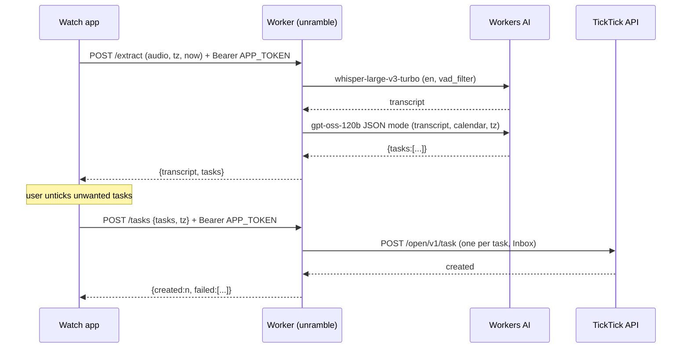

# Unramble: voice → TickTick tasks (Galaxy Watch 8)

Press a button on the watch, dictate, review the extracted tasks, and send them to the TickTick Inbox. (Working name was "Voice Tasks"; renamed to **Unramble** on 2026-11-17: app ID `dev.flashblaze.unramble`, Worker `unramble`. User-facing docs: `README.md`.)

## Decisions

| Topic | Choice | Why |
|---|---|---|
| Speech source | Dictation only: every word you say counts | No speaker separation needed, so it's more accurate |
| After processing | Review screen on the watch with toggles, then **Create** | Bad extractions never reach TickTick |
| AI provider | Cloudflare Workers AI: `@cf/openai/whisper-large-v3-turbo` + `@cf/openai/gpt-oss-120b` (JSON mode, `reasoning_effort: low`), falling back to `@cf/meta/llama-3.3-70b-instruct-fp8-fast` on error or after 25 s | Free at personal volume, one account, no extra API keys; Whisper on Workers AI is zero-data-retention; gpt-oss-120b scored 30/30 in Phase 0 |
| TickTick list | Inbox | — |
| Language | English (`language: "en"` passed to Whisper) | — |
| Max recording | 5 min, then it stops automatically | Ogg/Opus 16 kHz mono 24 kbps: about 800 KB, uploads in one go |
| Phone app | None | The watch talks to the Worker directly over Wi-Fi/LTE/Bluetooth proxy |

### Cost (Workers AI free allowance: 10,000 neurons/day)

Measured in Phase 0: Whisper 47 neurons per audio minute; gpt-oss-120b about 50 neurons per extraction (≈1k-token prompt).

| Per recording | Whisper | LLM | Total |
|---|---|---|---|
| 1 min | 47 | ~50 | ~100 neurons → ~100 recordings/day free |
| 5 min | 233 | ~50 | ~285 neurons → ~35 recordings/day free |

Above the free allowance (Workers Paid plan only): $0.011 per 1,000 neurons, about $0.003 per 5-minute recording.

## Architecture



Secrets are stored only as Worker secrets: `APP_TOKEN` (watch → Worker) and `TICKTICK_TOKEN`. The watch app holds only `APP_TOKEN`, read from `local.properties` into `BuildConfig` at build time, so it never reaches git. The Worker never stores audio.

## Repository layout

```
unramble/
  app/                    Wear OS app (Compose for Wear OS, Material3)
  worker/                 Cloudflare Worker (TypeScript, wrangler)
    src/index.ts          router, bearer auth, body limits, structured logs
    src/extract.ts        Whisper, prompt, gpt-oss-120b → llama fallback
    src/tasks.ts          zod schemas: Task, /tasks body, model output + grounding guard
    src/dates.ts          time-zone math: prompt calendar, local due → TickTick date
    src/ticktick.ts       TickTick client (Inbox)
    src/quota.ts          Durable Object: strict per-credential quota (10/min, 30 extracts/day)
    src/errors.ts         log-safe error summaries (no transcript text)
    scripts/auth.ts       TickTick OAuth on the laptop → .dev.vars + Worker secret
    scripts/wrangler.sh   runs wrangler with the cf CLI login
    test/                 vitest in the Workers runtime (@cloudflare/vitest-plugin)
  PLAN.md
```

## Task JSON (the contract between LLM, Worker and watch)

The LLM returns, per task (field order matters, see Phase 0):
`title`, `when_said` (your exact timing words), `due`, `priority_said` (your exact importance words), `priority`, `notes`.

The Worker enforces the grounding in code: no `when_said` → `due` dropped; no `priority_said` → `priority = 0`. It then returns this to the watch:

```json
{
  "transcript": "remind me to call the bank tomorrow at 10 and also buy milk",
  "tasks": [
    { "title": "Call the bank", "due": "2026-11-17T10:00", "priority": 0 },
    { "title": "Buy milk", "priority": 0 }
  ]
}
```
- `due` is local time without an offset: `YYYY-MM-DD` (all day) or `YYYY-MM-DDTHH:MM` (timed), or absent. The watch sends its zone (e.g. `Asia/Kolkata`), and the Worker converts to TickTick's `yyyy-MM-dd'T'HH:mm:ssZ` (with offset) plus `timeZone`. Phase 0 confirmed `2026-11-17T10:00:00+0530` with `timeZone: Asia/Kolkata` is stored as 10:00 IST.
- `priority` maps to TickTick: 0 none, 1 low, 3 medium, 5 high.
- `notes` (optional) becomes the TickTick task `content`.
- The Worker validates every field (title 1–200 chars, date parses, priority in the allowed set). Invalid items are dropped, never sent to TickTick.

## Phases

### Phase 0: risk spikes ✅ done 2026-11-16
Harness and samples: `worker/spike/` (gitignored). Prompt to port: `worker/spike/prompt-v4.txt`, schema: `worker/spike/schema-v4.json`.

1. **Whisper input ✅** Test audio was a TTS-generated dictation, looped to 5 min, 16 kHz mono.

   | Clip | Size | Time | Result |
   |---|---|---|---|
   | 5 min Ogg/Opus 24 kbps | 804 KB | 25.6 s | 920 words, accurate |
   | 5 min M4A/AAC 32 kbps | 1.17 MB | 35.2 s | 921 words, accurate |

   Single call, no splitting needed. **Use Ogg/Opus**: smaller and faster.
   Quirks: Whisper invents a "Thank you." on trailing silence, and long audio loses capitalization partway through. The prompt ignores a stray "thank you"; casing doesn't matter to the LLM.
2. **LLM extraction ✅** 10 cases (multi-task ramble, no tasks, no date, time today, self-correction, recurring, other people's actions, item list, "in two hours" across midnight, "a week before Dec 3"), 3 runs each, scored automatically.

   | Prompt | llama-3.3-70b | gpt-oss-120b | qwen3-30b |
   |---|---|---|---|
   | v1: plain rules | ~5/10 | — | — |
   | v2: + 15-day calendar table | 8/10 | 9/10 | 9/10 |
   | v3: + 45-day calendar | 24/30 | 26/30 | 26/30 |
   | **v4: 21-day calendar + `when_said`/`priority_said` grounding + code guard** | 29/30 | **30/30** | 29/30 |

   What fixed it: the model looks weekdays up in a calendar instead of computing them. It must quote your timing and importance words before giving a date or priority, and the Worker drops any date or priority without a quote. gpt-oss-120b: p50 6.6 s, max 23.8 s.
3. **TickTick ✅** `scripts/auth.ts` (localhost:8765 OAuth) works, and the token lasts **180 days**. `POST /open/v1/task` **without `projectId`** lands in Inbox (project ID `inbox<user-id>`). `DELETE /open/v1/project/{pid}/task/{id}` works.

Worst case per request: upload + 26 s Whisper + 24 s LLM ≈ 60 s, so the watch timeout is 120 s.

### Phase 1: Worker ✅ done 2026-11-16
Deployed on a custom domain, **`https://unramble.<your-domain>`** (`routes` + `"workers_dev": false` in `wrangler.jsonc`; logs and traces on at 100%). It started on `workers.dev` under the working name `voice-tasks`. Code in `worker/`. Commands (run in `worker/`):

| Command | What |
|---|---|
| `bun run deploy` | deploy (wrangler borrows the `cf` CLI login via `scripts/wrangler.sh`) |
| `bun run auth` | TickTick OAuth → `.dev.vars` + Worker secret `TICKTICK_TOKEN` (rerun every 180 days) |
| `bun run test` / `bun run typecheck` | 34 tests in the Workers runtime / tsc |
| `bun run types` | regenerate `worker-configuration.d.ts` after changing `wrangler.jsonc` |
| `bun run wrangler tail unramble` | live logs (JSON: request ID, sizes, task count, model, whisperMs, llmMs, never transcript text) |

**API** (all routes: `POST`, `Authorization: Bearer <APP_TOKEN>`; errors are `{"error": "<code>"}`):

| Route | Body | 200 response | Errors |
|---|---|---|---|
| `/extract?tz=<IANA zone>` | raw Ogg/Opus audio, ≤ 1.5 MB | `{transcript, tasks: [{title, due?, priority, notes?}]}` | 400 `bad_timezone` / `empty_audio`, 413 `too_large`, 422 `no_speech` |
| `/tasks` | `{tz, tasks: [...]}` (1–20, as returned by `/extract`) | `{created: [{title, id}], failed: [{index, title, error}]}` | 400 `bad_request` / `bad_timezone`, 413 `too_large`, 502 `ticktick_auth_expired` (+ `created` so far) |

Shared: 401 `unauthorized` (checked before anything else), 429 `rate_limited` + `Retry-After` (quota, below), 404 `not_found`, 405 `method_not_allowed`, 500 `internal`. Retry `/tasks` with only the `failed` **positions** (`index`), so nothing is duplicated even when titles repeat.

**Verified:**
- `curl` with the 30 s dictation returned 5 correct tasks: dates, all-day vs timed, and priority 5 for "high priority". `/tasks` created all 5 in Inbox. Read back from TickTick: 10:00 IST is stored as `04:30Z`, all-day dates as local midnight. Test tasks deleted afterwards.
- Latency: Whisper about 5 s for 30 s of audio. gpt-oss-120b at default effort took 29 s under load. With `reasoning_effort: low` the typical response is 7.7 s and accuracy still 29/30; its one failure was the test client's own 60 s timeout. Requests that stall past 25 s fall back to llama. End to end: 30 s clip about 19–35 s, 5-min clip 57 s.
- The Worker sends gpt-oss the JSON schema in OpenAI format (`json_schema: {name, schema}`): re-evaluated at 30/30.

Gotchas:
- A first deploy with `secrets.required` needs `bun run deploy -- --secrets-file .dev.vars`, because a Worker that doesn't exist yet can't take `secret put`.
- `.dev.vars` holds `APP_TOKEN` and `TICKTICK_TOKEN`; `.env` holds the TickTick client ID and secret. Both are gitignored.

### Phase 2: watch app ✅ done 2026-11-17
Code in `app/src/main/java/dev/flashblaze/unramble/`:

| File | What |
|---|---|
| `RecorderService.kt` | Foreground service (type microphone): MediaRecorder Ogg/Opus, 16 kHz mono, 24 kbps → `cacheDir/dictation.ogg`, auto-stop at 5:00, Wear Ongoing Activity chip with a stopwatch. Publishes `Recorder.state` (Idle / Recording / Finished / Failed) so the UI resumes after screen-off or activity recreation. |
| `TasksApi.kt` | OkHttp + kotlinx.serialization client for `/extract` and `/tasks` (120 s timeout); Worker errors → `ApiException(code)` |
| `MainViewModel.kt` | State machine `Idle → Recording → Uploading → Review → Creating → Done`, plus `NothingHeard`, `Error(retry)`, `MicPermissionDenied`. Keeps the audio until tasks are created, so Retry never re-records; a partial `/tasks` failure keeps only the failed tasks. |
| `MainActivity.kt` | Compose for Wear OS Material3 screens. Every screen is a `TransformingLazyColumn`, so text scrolls on the round display. |

Config: `unramble.workerUrl` and `unramble.appToken` in `local.properties` (gitignored) → `BuildConfig`. Unit tests: `./gradlew :app:testDebugUnitTest` (`TasksApiTest`: request body and error mapping).

**Verified on the Wear OS 6 emulator:**
- Mic and notification permission prompts.
- Foreground service running with type microphone (`0x80`), stopwatch notification.
- Recording → upload → Review in about 5–9 s for a 4 s phrase.
- "No speech heard" path.
- Acceptance: "Buy milk, and call mom tomorrow at 6 PM" → Review lists **Buy milk** and **Call mom · Tomorrow 18:00** → Add 2 → "Added 2 tasks to TickTick". Read back from TickTick: Call mom `2026-11-18T12:30Z` (18:00 IST, timed), Buy milk undated, both in Inbox. Test tasks deleted afterwards.

Fixed along the way:
- **`/tasks` returned `bad_request`:** kotlinx.serialization skips default values, so `priority: 0` was never sent. Fixed with `encodeDefaults = true` (nulls are still omitted via `explicitNulls = false`), and a regression test added.
- Wear M3 `TextButton` is a small round icon button, so labels wrapped. Secondary actions now use `CompactButton`.
- The recording screen has a big central Stop button instead of an edge button.
- `Status.StopwatchPart` counts from an `elapsedRealtime()` base (checked in the bytecode), not wall-clock time.

UI notes: the edge button (e.g. "Add 2") collapses while the list can still scroll and appears at the end, the standard Wear pattern; scroll with the crown/bezel. "Buy milk and call mom tomorrow at 6 PM" sometimes gives *both* tasks the date. The sentence is ambiguous, and the review screen shows it.

**Emulator testing notes** (this machine): the emulator can't open PipeWire/PulseAudio/ALSA (`Could not init 'pa' audio driver`), so host-mic tests are impossible. Instead, `tools/emulator/inject_audio.py --burst` streams a WAV into the virtual mic through gRPC `injectAudio`. Start the emulator with `-grpc 8554 -grpc-use-token`; plain `-grpc` listens on all interfaces without auth. Gotchas:
- Injecting when no guest app is recording **crashes the emulator** (SIGSEGV).
- Injection is flaky: roughly 1 in 3 recordings receive the audio.
- A cold boot shows the "Hello" onboarding over the app; swipe up once.

`tools/emulator/tap.sh "<label>"` taps a UI node by its text.

### Security audit + code review fixes ✅ 2026-11-17
A read-only security audit and a code review found no critical or high issues. Fixed:

| # | Finding | Fix |
|---|---|---|
| 1 | Retrying a partial `/tasks` failure matched by **title**, so same-titled tasks were re-created | `failed[]` carries `index`; the app retries `CreateResult.failedOf(sent)` by position. Regression tests: Worker `index.test.ts` and app `TasksApiTest` |
| 2 | No rate limit; `APP_TOKEN` ships in the APK, so a leaked token could drain the account's Workers AI free allowance (~35 five-minute requests) or flood the Inbox | **Strict per-credential quota**, Durable Object `src/quota.ts` (SQLite, synchronous): **10 requests/min** and **30 `/extract` per rolling 24 h** (≤ ~8.5k neurons). Checked right after auth, so unauthenticated requests can't lock you out. The Workers Rate Limiting binding was tried first: it is approximate and per location, and never tripped in 80 test requests. Audio cap lowered from 3 to 1.5 MB. Verified live: 10 × 404 then 429 with `Retry-After`. |
| 3 | An over-long title or notes dropped the whole task silently | Truncated to 200 / 2,000 characters instead (test added) |
| 4 | A blank `WORKER_URL` crashed the app at ViewModel creation | `TasksApi` is created lazily; `record()` shows the config error |
| 5 | Error logs could include transcript text (JSON parse errors quote model output; TickTick error bodies) | `errorSummary()`: parse errors logged by name only, other messages capped; `TickTickError` carries only the status |
| 6 | Review screen hid notes and priorities 1 and 3, which were still sent | Shows date · Low/Medium/High plus notes (up to 4 lines) |
| + | A stalled gpt-oss call kept running (and using neurons) after the 25 s fallback | `ai.run(..., { signal: AbortSignal.timeout(25_000) })` |
| + | `allowBackup="true"` | `false` |

**Accepted for a personal app:**
- Blocking OkHttp calls aren't cancelled when the app is swiped away, so in-flight results are lost.
- An unexpected response shape throws `SerializationException`, which is uncaught.
- A double Stop leaves an idle service running.
- DST-gap date math is off for some zones (Asia/Kolkata has no DST).
- The TickTick scope includes `tasks:read`.
- `APP_TOKEN` is readable from the APK. Rotate it if the APK leaks: `bun run wrangler secret put APP_TOKEN`, update `local.properties`, reinstall.

Git history scanned: no secret values are present in any commit.

### Phase 2b: transcript history (planned)
Goal: keep every dictation so you can look back at what you said, what the model extracted, and what you actually added.

**Storage decision: D1.**

| Option | Fit |
|---|---|
| **D1** ✅ | Small text rows you list by date and search. Full SQL; **FTS5** full-text search; dashboard console; `wrangler d1 execute` from the CLI; migrations; **Time Travel** restore to any minute in the last 30 days. Free tier: 5 GB, 100k rows written and 5M rows read per day. |
| R2 | Object storage for blobs: no queries, and listing only by key prefix. It's the right place for *audio*, which we don't keep. Possible later as an opt-in, referenced from a D1 row (`audio/<id>.ogg`) with a lifecycle rule to expire it. |
| Durable Object (SQLite) | `Quota` already uses one, but its data can only be reached through Worker code (no console, CLI or backups), and it would couple history to the rate limiter. D1 is SQLite with the tooling around it. |

**Schema** (`worker/migrations/0001_dictations.sql`):
```sql
CREATE TABLE dictations (
  id             TEXT PRIMARY KEY,      -- UUID, returned to the watch as dictationId
  created_at     INTEGER NOT NULL,      -- unix ms
  tz             TEXT NOT NULL,
  outcome        TEXT NOT NULL,         -- 'extracted' | 'no_speech'
  transcript     TEXT NOT NULL,
  audio_bytes    INTEGER NOT NULL,
  model          TEXT,                  -- which LLM answered (null for no_speech)
  extracted_json TEXT,                  -- tasks the model proposed
  submitted_json TEXT,                  -- tasks you kept and sent to TickTick
  created_count  INTEGER,               -- tasks TickTick actually created (incl. retries)
  whisper_ms     INTEGER,
  llm_ms         INTEGER
);
CREATE INDEX dictations_created_at ON dictations (created_at DESC);
-- Full-text search over transcripts, kept in sync by triggers (insert / delete / update of transcript).
CREATE VIRTUAL TABLE dictations_fts USING fts5 (transcript, content = 'dictations', content_rowid = 'rowid');
```
Estimated size: about 2 KB per dictation, so 1 GB holds about 500k dictations. Writes are about 5 rows per dictation (insert, update, search-index entries), so 30 a day is roughly 150 rows against the 100k/day free allowance.

**Worker**
- `wrangler.jsonc`: `d1_databases: [{ binding: "DB", database_name: "unramble", migrations_dir: "migrations" }]` with no `database_id`. Wrangler provisions the database on the first deploy and writes the ID back, so forks get their own database automatically. Apply migrations with `wrangler d1 migrations apply unramble --remote`.
- `src/history.ts`: `recordExtraction()` and `recordSubmission()`. Both run in `ctx.waitUntil()` after the response is sent: a D1 failure is logged (`errorSummary`) and never fails or slows a dictation.
- `/extract`: generates `dictationId`, records the transcript, extracted tasks, model and timings (including `no_speech` outcomes), and returns `dictationId` in the response.
- `/tasks`: accepts an optional `dictationId`. On the first submission it stores `submitted_json`, then `created_count = COALESCE(created_count, 0) + created`, so retries add up instead of overwriting.
- **No HTTP read endpoint.** Reading history needs your Cloudflare account, so a leaked `APP_TOKEN` can still only write dictations, not read them.
- Settings, as `vars` in `wrangler.jsonc`:
  - `SAVE_TRANSCRIPTS = "true"`: forks can turn history off.
  - `HISTORY_RETENTION_DAYS = "0"` (keep forever). Above 0, a daily cron (`scheduled` handler, `triggers.crons`) deletes older rows, and the triggers keep the search index in step.

**App:** `Extraction.dictationId` (optional) is kept in the ViewModel and sent with `/tasks`, including on retries. No new screens: the watch is the wrong place to browse history.

**Viewing it later**
- `bun run history` lists the last 20 dictations: local time, outcome, transcript, proposed titles vs the ones you kept, and how many were created.
- `bun run history --search "plumber"` searches transcripts with FTS5 and highlights matches.
- `bun run history --id <uuid>` shows one dictation in full (JSON).
- `bun run history --purge-older-than 90d` deletes old rows by hand.
- For anything else: Cloudflare dashboard → Storage & databases → D1 → `unramble` → **Console** for raw SQL, or `bun run wrangler d1 export unramble --remote --output history.sql`.
- The script runs `wrangler d1 execute --remote --json` through `scripts/wrangler.sh`, with search terms escaped.

**Privacy and docs**
- README "Security and privacy" changes from "transcripts are never stored" to "transcripts (text, never audio) are stored in **your** D1 database; turn off with `SAVE_TRANSCRIPTS`".
- Deleted rows stay recoverable through Time Travel for 30 days.
- Workers Logs stay transcript-free.

**Tests (vitest, migrations applied in the test runtime):**
- record → fetch round trip
- FTS search finds a word inside a transcript
- `/tasks` with a `dictationId` sets `submitted_json` and adds to `created_count` across a retry
- retention purge deletes only old rows (with the search index still consistent)
- a D1 failure doesn't change the `/extract` response

**Done when** a dictation on the emulator appears in `bun run history` with its transcript, proposed tasks, kept tasks and `created_count`; `--search` finds it; all tests pass; and the docs reflect the new privacy model.

### Phase 3: real watch
- Pair over Wi-Fi debugging and install with `./gradlew installDebug`.
- Check: recording continues with the screen off, upload works over Bluetooth-via-phone and over Wi-Fi alone, a 5-minute recording uploads and processes, and battery use for 10 recordings is acceptable.
- Mirror with `scrcpy` while testing.

**Done when** 5 real dictations in different conditions (quiet, walking, outdoors) all produce correct tasks.

### Phase 4: hardening
- `ticktick_auth_expired` → the watch shows "TickTick login expired: run `bun run auth` in worker/".
- Worker logs record request IDs, durations, task counts and error types, never transcript text.
- Upload size and duration limits enforced on both sides.
- README section: setup, secrets, re-auth, cost.

## Out of scope (possible later)
- Recording real conversations with several speakers (needs speaker separation)
- Choosing the list automatically, tags, subtasks, reminders
- A Tile or complication to start recording from the watch face
- Offline queue for recordings made with no connection
- Play Store release (needs a privacy policy and Data safety form for microphone use)

## What the user must provide
1. ✅ TickTick developer app (client ID + secret in `worker/.env`, gitignored), redirect URI `http://localhost:8765/callback`.
2. ✅ Cloudflare auth: the `cf` CLI login is used instead of `wrangler login`.
3. For Phase 3: the watch's IP, port and pairing code (from Wireless debugging).
