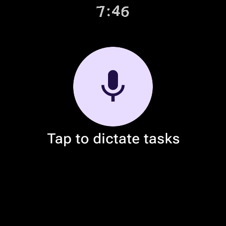
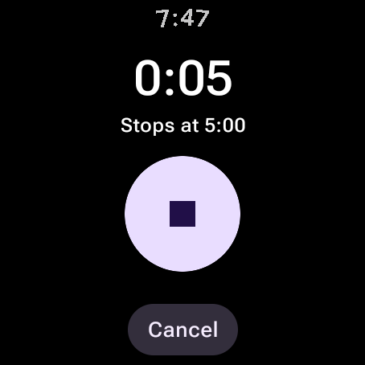
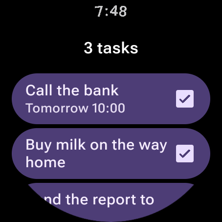
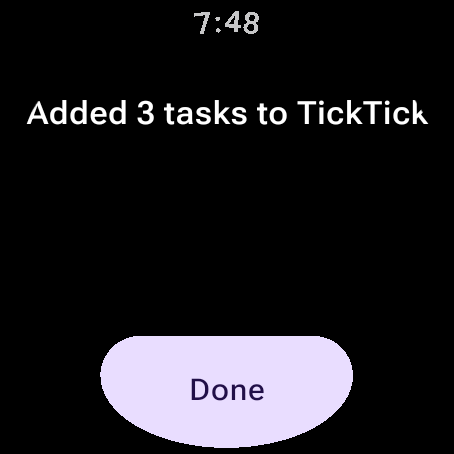
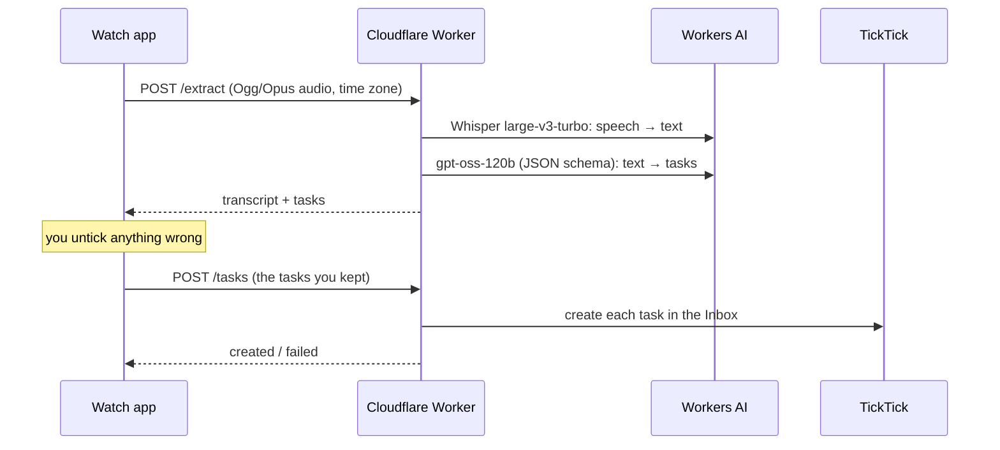

# Unramble

**Ramble at your Wear OS watch and get clean TickTick tasks.** Dictate however it comes out, check what it heard, and the tasks land in your **TickTick** Inbox.

You tap the mic on your wrist and talk normally. For example: *"Okay, call the bank tomorrow around ten about the card charge, buy milk on the way home, and send the quarterly report to Priya by Thursday evening, that's high priority."* The watch then shows three tasks, with dates and priority filled in from what you said. Untick anything that's wrong and tap **Add**.

| Record | Recording | Review | Done |
|---|---|---|---|
|  |  |  |  |

- **Standalone:** no phone app. The watch talks to your own Cloudflare Worker over Wi-Fi, LTE, or the phone's Bluetooth connection.
- **Dates and priorities only when you say them.** The model must quote your words ("tomorrow around ten", "high priority") before it can set a due date or priority; anything it can't back with a quote is dropped.
- **Nothing reaches TickTick until you confirm** on the watch.
- **Runs on Cloudflare's free tier** at personal volume: about 100 neurons per minute of dictation, against 10,000 free per day.
- **Private by design:** audio and transcripts are never stored, and logs never contain what you said.

> Built for a Galaxy Watch 8 (Wear OS 6), and works on any Wear OS 3+ watch. So far it has been tested end to end on the Wear OS 6 emulator.

---

## How it works



1. **Recording.** A foreground service records 16 kHz mono **Ogg/Opus** at 24 kbps (about 3 KB/s, under 1 MB for the 5-minute maximum). It keeps recording with the screen off, and a stopwatch chip on the watch face shows that it's running.
2. **Transcription.** The Worker sends the audio to `@cf/openai/whisper-large-v3-turbo`. A 30-second clip takes about 5 s.
3. **Task extraction.** The transcript goes to `@cf/openai/gpt-oss-120b`, which has to return JSON matching a schema. Two techniques make the dates reliable:
   - **A calendar in the prompt.** The prompt lists the next 21 days with their weekdays ("Thu 2026-11-19"), plus "in 1/2/3 hours" times, all in the watch's time zone. The model looks dates up instead of calculating them; calculating was where models kept failing.
   - **Quote your words first.** For each task the model must fill in `when_said` (your exact timing words) before `due`, and `priority_said` before `priority`. The Worker then drops any date or priority that has no quote behind it, so the model can't make one up.

   Measured on 10 tricky dictations × 3 runs: this setup scored **30/30**, against about 50% for a plain prompt. If gpt-oss errors or stalls for more than 25 s, the Worker retries once with `@cf/meta/llama-3.3-70b-instruct-fp8-fast`.
4. **Review.** The watch lists every task with its date, priority, and notes, everything that will be sent, each with a checkbox.
5. **Create.** The Worker creates the tasks one by one through the [TickTick Open API](https://developer.ticktick.com/), converting dates to your time zone. If some fail, the watch retries only those.

End to end, a short dictation takes about 5–25 s, depending on Workers AI load; a 5-minute one about 60 s.

### What it costs

| | Neurons |
|---|---|
| Whisper | 47 per audio minute |
| gpt-oss-120b | ≈ 50 per dictation |
| **1-minute dictation** | **≈ 100**, so about 100 per day free |
| 5-minute dictation | ≈ 285 |

Workers AI gives you 10,000 neurons per day for free; beyond that, on the Workers Paid plan, it costs $0.011 per 1,000 neurons. A built-in quota (see [Security](#security-and-privacy)) keeps a leaked token from spending more than about 30 dictations a day.

---

## Setup

### Prerequisites
- A **Cloudflare** account (free).
- A **TickTick** account.
- [**Bun**](https://bun.sh) 1.x.
- **Android Studio**, or the Android SDK command-line tools. Gradle downloads the JDK it needs.
- A **Wear OS 3+ watch**, or the Wear OS emulator from Android Studio.

```bash
git clone <this repo> unramble && cd unramble
```

### 1. Create a TickTick developer app
1. Go to <https://developer.ticktick.com/manage> and click **New App**. Name it anything (for example *Unramble*); the name only appears on the consent page.
2. Set **OAuth redirect URL** to exactly `http://localhost:8765/callback`.
3. Copy the **Client ID** and **Client Secret** into `worker/.env`:

```bash
cd worker
cp .env.example .env        # then fill in TICKTICK_CLIENT_ID and TICKTICK_CLIENT_SECRET
```

### 2. Deploy the Worker
```bash
bun install
bunx wrangler login                                     # opens the browser

# Shared secret between the watch and the Worker
printf 'APP_TOKEN=%s\n' "$(openssl rand -hex 32)" > .dev.vars && chmod 600 .dev.vars

bun run auth                                            # TickTick login → adds TICKTICK_TOKEN to .dev.vars
bun run deploy -- --secrets-file .dev.vars              # first deploy uploads both secrets
```

- `bun run auth` opens TickTick's consent page; click **Authorize**. On the very first run it can't upload the token yet, because the Worker doesn't exist; that's expected, and the deploy step uploads it.
- `bun run deploy` prints your URL, `https://unramble.<your-subdomain>.workers.dev`.

**Optional smoke test:** this creates a real task in your Inbox.
```bash
curl -X POST "https://unramble.<your-subdomain>.workers.dev/tasks" \
  -H "Authorization: Bearer $(sed -n 's/^APP_TOKEN=//p' .dev.vars)" \
  -H 'Content-Type: application/json' \
  -d '{"tz":"UTC","tasks":[{"title":"Hello from Unramble","priority":0}]}'
# → {"created":[{"title":"Hello from Unramble","id":"…"}],"failed":[]}
```

### 3. Build the watch app
Add your Worker URL and the same `APP_TOKEN` to **`local.properties`** at the repo root. The file is gitignored; Android Studio creates it with `sdk.dir`.

```properties
unramble.workerUrl=https://unramble.<your-subdomain>.workers.dev
unramble.appToken=<APP_TOKEN from worker/.dev.vars>
```

```bash
cd ..                                   # repo root
./gradlew :app:assembleDebug
```

If you'll share your own build, change `applicationId` in `app/build.gradle.kts` first.

### 4. Install it

**Emulator:** in Android Studio, open **Device Manager** → **Create device** → **Wear OS** → *Large Round*, with system image **Wear OS 6 (API 36)**. Start it, then:
```bash
./gradlew :app:installDebug
```

**Real watch** (no USB on most watches, so pair over Wi-Fi):
1. On the watch, open **Settings → About watch → Software** and tap **Software version** 5 times. This enables Developer options.
2. In **Developer options**, turn on **ADB debugging** and **Wireless debugging**. Keep the watch on the same Wi-Fi as your computer.
3. Tap **Wireless debugging → Pair new device**, then run:
```bash
adb pair <ip>:<pair-port> <pairing-code>
adb connect <ip>:<port>                 # the port shown on the main Wireless debugging screen
./gradlew :app:installDebug
```
`scrcpy -s <ip>:<port>` mirrors the watch on your computer, which is handy while testing. Turn Wireless debugging off afterwards; it drains the battery.

---

## Using it
1. Open **Unramble** and tap the mic. The first time, allow the **microphone** and **notifications**; notifications power the recording chip on the watch face.
2. Talk. Recording continues with the screen off, and it stops automatically at **5:00**.
3. Tap **Stop**. After a few seconds you see the tasks it found.
4. Untick anything wrong, scroll to the end (crown or bezel), and tap **Add N**.

**Phrases it understands:**

| You say | It sets |
|---|---|
| "tomorrow", "Friday", "next Friday" | that date, all day |
| "tomorrow at 6 pm", "tonight", "in two hours" | a date and time (morning 09:00, afternoon 14:00, evening and end of day 18:00, tonight 20:00) |
| "by Thursday" / "before Thursday" | Thursday / Wednesday |
| "next week" | next Monday |
| "a week before the 3rd of December" | 26 Nov |
| "urgent", "ASAP", "important", "high priority" | High priority |
| "medium priority" / "low priority" | Medium / Low |
| "…never mind", "Rahul will send it" | nothing (dismissed, or someone else's task) |
| "actually, make it Wednesday" | the corrected value |

No date words means no date, and no priority words means no priority.

---

## Configuration

| What | Where | Default |
|---|---|---|
| Max recording length | `app/.../RecorderService.kt`, `MAX_DURATION_MS` | 5 min |
| Audio upload cap | `worker/src/index.ts`, `MAX_AUDIO_BYTES` | 1.5 MB |
| Request quota | `worker/src/quota.ts`, `PER_MINUTE`, `EXTRACTS_PER_DAY` | 10/min, 30 dictations per 24 h |
| Models | `worker/src/extract.ts` | Whisper large-v3-turbo; gpt-oss-120b → llama-3.3-70b |
| Language | `worker/src/extract.ts`, Whisper `language` | `en` |
| Which TickTick list | `worker/src/ticktick.ts` (no `projectId` = Inbox) | Inbox |

---

## Security and privacy

- **Watch → Worker:** every request carries `Authorization: Bearer <APP_TOKEN>`, which is compared in constant time. Unauthenticated requests get `401` before anything else happens.
- **The token is in the APK.** It's compiled in through `BuildConfig`, so anyone holding your APK can extract it. That's fine for a personal, sideloaded app; don't publish your APK. To rotate the token: `bun run wrangler secret put APP_TOKEN`, update `local.properties`, reinstall.
- **Quota.** A Durable Object (`worker/src/quota.ts`) strictly limits each credential to **10 requests per minute** and **30 dictations per rolling 24 h**, returning `429` with `Retry-After`. Even a leaked token can't run up AI costs or flood your Inbox.
- **TickTick token** (180 days, no refresh): it's stored only as a Worker secret and in your local `.dev.vars`. When the watch shows *"TickTick login expired"*, run `bun run auth` again.
- **What's stored:** nothing. Audio and transcripts exist only for the duration of a request. On the watch, the recording sits in the app's private cache until the tasks are created. Whisper on Workers AI is zero-data-retention. Logs contain request IDs, sizes, timings, task counts and error *types*, never transcript text.
- **What the model can do:** only return JSON. The Worker validates every field (zod) and has no tools. Whatever you say can only ever turn into suggested tasks, which you approve.

---

## Development

```bash
# Worker
cd worker
bun run test          # vitest inside the Workers runtime
bun run typecheck
bun run dev           # local Worker; the AI binding always calls Cloudflare (uses neurons)
bun run wrangler tail unramble   # live logs

# Watch app
./gradlew :app:testDebugUnitTest
```

**Testing dictation on the emulator.** On some Linux setups the emulator can't use the host microphone (`Could not init 'pa' audio driver`). `tools/emulator/inject_audio.py` streams a WAV file into the emulator's virtual mic over its gRPC API instead. It's Linux-only as written, because it reads the emulator's discovery file under `/run/user/$UID`.

```bash
emulator -avd <your-wear-avd> -grpc 8554 -grpc-use-token     # -grpc alone listens on all interfaces without auth
# start recording in the app first. Injecting when nothing is recording can crash the emulator
uv run --with grpcio --with grpcio-tools tools/emulator/inject_audio.py speech.wav --burst
tools/emulator/tap.sh "Stop"                                   # tap a UI element by its label
```

Injection is flaky: about 1 in 3 recordings actually receive the audio. Check for "No speech heard" and retry.

### Project layout
```
app/                       Wear OS app: Kotlin, Compose for Wear OS Material3
  RecorderService.kt       microphone foreground service, Ogg/Opus recorder, Ongoing Activity
  TasksApi.kt              OkHttp + kotlinx.serialization client for the Worker
  MainViewModel.kt         record → upload → review → create state machine
  MainActivity.kt          screens
worker/                    Cloudflare Worker: TypeScript
  src/index.ts             routing, auth, quota, body limits, logs
  src/extract.ts           Whisper, prompt, model fallback
  src/tasks.ts             zod schemas and the quote-before-date guard
  src/dates.ts             time-zone math: prompt calendar, TickTick dates
  src/ticktick.ts          TickTick client
  src/quota.ts             Durable Object quota
  scripts/auth.ts          TickTick OAuth helper (localhost:8765)
tools/emulator/            emulator mic injection and UI tap helpers
PLAN.md                    design log: decisions, measurements, review findings
```

### API

| Route | Body | Response |
|---|---|---|
| `POST /extract?tz=<IANA zone>` | raw Ogg/Opus audio, ≤ 1.5 MB | `{transcript, tasks: [{title, due?, priority, notes?}]}` |
| `POST /tasks` | `{tz, tasks: [...]}`, 1–20 tasks | `{created: [{title, id}], failed: [{index, title, error}]}` |

- `due` is local time: `YYYY-MM-DD` (all day) or `YYYY-MM-DDTHH:MM`.
- `priority`: 0 none, 1 low, 3 medium, 5 high.
- Errors are `{"error": "<code>"}`: `unauthorized`, `rate_limited`, `bad_timezone`, `empty_audio`, `too_large`, `no_speech`, `bad_request`, `ticktick_auth_expired`, `internal`.

---

## Troubleshooting

| Watch shows | Fix |
|---|---|
| *TickTick login expired* | `cd worker && bun run auth` |
| *Worker rejected the app token* | `unramble.appToken` doesn't match the Worker's `APP_TOKEN`; rebuild after fixing it |
| *Too many requests* | quota reached; wait for the minute or day to roll over |
| *No speech heard* | the mic captured silence; check the microphone permission (or, on the emulator, see above) |
| *No connection* | the watch has no internet; check Wi-Fi or the phone connection |
| *Set unramble.workerUrl…* | add both keys to `local.properties` and rebuild |

## Limitations
- English only (set Whisper's `language` to change it).
- Meant for **dictating your own tasks**. It doesn't separate speakers, so a recorded conversation can mix up whose task is whose.
- Tasks always go to the Inbox; no lists, tags, subtasks, or reminders yet.
- Personal-use security model: one shared token, compiled into the APK.
